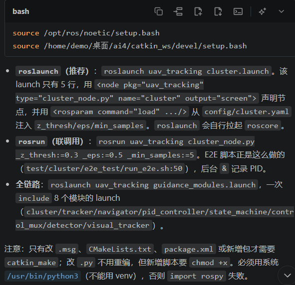
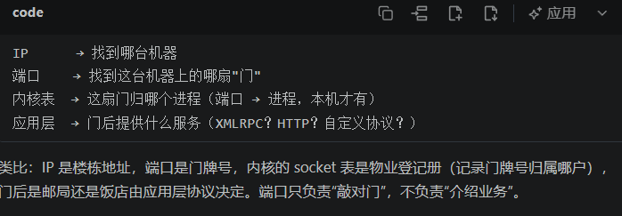
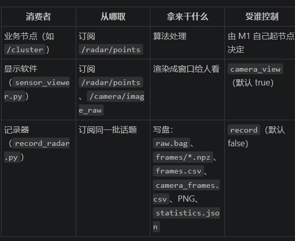

接收方检查：
1. 能否接受到符合规范的数据
2. 能否通过符合规范规范的数据输出符合预期的输出
3. 输出是否符合预期


疑惑：
Q1：如果我想一键拉起所有的模块，现在可以做到吗？还是说需要分开做？
A1：使用launch来拉起，并且拉起节点后，需要给数据源--》py文件



Q2：删除M0主动拉起M1的操作后，是否还能时刻保存雷达数据和相机数据？
A2：可以，将record:=改成true即可


# 联调经验


需要硬件通过connection.bash来统一master的URI

【以cluster与仿真环境为例】
```

# 终端 A（你平时的入口，不用改）
bash catkin_ws/src/uav_sim/scripts/start_mounted_radar.sh
# 记下它打印的「雷达/相机数据目录：$RUN_DIR」

# 终端 B（M1）
cd /home/demo/桌面/ai4
source /opt/ros/noetic/setup.bash
source catkin_ws/devel/setup.bash
source data/radar/<最新 run_dir>/connection.bash   # ← 关键这一步
roslaunch uav_tracking cluster.launch

```

connection.bash的作用：在这个终端下改变ROS_MASTER_URI的值，从而把后续roslauch创建的ros节点挂靠在改后的ROS_MASTER_URI对应的ros图上。


## master与端口介绍
master:一个进程。即一个独立正在运行的代码活体
    组成：存储注册表（存储有哪些节点，对应一个ros图）+参数服务器（存储参数）
    特点：
        1】不具备跨master的自动发现，每个master独自保管自己的注册表和参数服务器
        2】由roscore，roslaunch（优先看有没有现成的master进程）创建
        3】默认占用的端口号为11311


端口：
    定义：一个寻址编号，常常一个服务配备一个端口。同时，一个进程可以具有多个服务，所以可以挂靠多个端口
    特点：同一个端口在同一时刻只能被一个进程使用---》可以通过反向确定锁定那个进程
    

## 节点删除

```
# ── 关闭 M1 ──
Ctrl+C                          # 推荐，最干净

# 或只杀节点、保留 roslaunch 交互
rosnode kill /cluster

# ── 确认真的退了（这一步别省）──
rosnode list | grep cluster     # 应无输出

# ── 重新开启（同一个终端，环境变量还在）──
roslaunch uav_tracking cluster.launch

```

## 节点参数修改
需要先把这个节点删除了才能进行修改

```

方法1：
# 调参（一条命令看完，值全显式给出，不依赖任何残留）
rosrun uav_tracking cluster_node.py _z_thresh:=-0.3 _eps:=0.2 _min_samples:=3

rosparam delete /cluster # 删除存储在master里面的cluster的参数值--》恢复默认

```


# 模块介绍

## M0
输出数据到节点上，然后后面存在三类消费者：

即后续的工作节点，显示器节点和记录者节点

M0的master节点挂靠在随机的URI上，所以联调时为了统一ros图，需要其他节点的终端修改ROS_MASTER_URI的值再用roslaunch开启节点。


