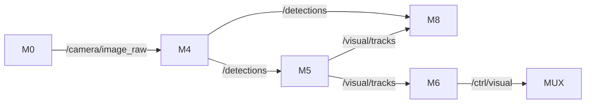

# 实际数据流与官方图比对

与design/方案设计/函数调用关系图-flowchart.md和函数接口一致。detector_node仅Publisher /detections与debug；visual_tracker_node订阅/detections及相机，发布/visual/tracks；pid_controller_node只订阅/visual/tracks，无/detections直接订阅。检查launch/YAML未见把检测remap成航迹的映射。M8分别订阅两路，航迹只缓存、检测才推进。本轮不改任何节点、算法、launch、YAML或msg。

原04_M4-PID_控制响应.mp4名称是历史误导标签：实际人工VisualTrackArray→M6，临时320/240；不是M4直接发布航迹，不是正式M5→M6实时联调。原名/SHA/日期全部保留在索引，仅增加归属注释。M8受控N/M/K不是M4或M5自身独立功能。

M4模型/检测/性能及M0-M4归M4；M5跟踪/ID/面积/清轨归M5；PID尺寸/符号、M8控制验证为跨模块参考。历史混合报告保留，只加说明；原始日志/SHA不改写。迁移对应表列明git mv，历史索引的source_archive仍指原归档位置，repository_path按新路径更新。
