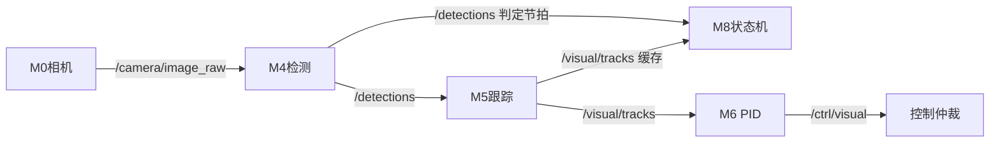

# M4与M5最终联调交付总览（2026-11-16）

本次归档补齐05/06人工OBS及原始轻量证据，不重跑联调。M4只检测，M5只跟踪；接口/模型/算法不变，M6/M8正式接收方签认及完整飞行另行负责。

|录像|来源/范围|结论|
|---|---|---|
|01_M0-M4_相机检测.mp4|11月14日真实Gazebo|M4基础接入/检测/空输出通过，漏检保留|
|02_M4-M5_视觉跟踪.mp4|11月14日真实Gazebo|M5建轨/移动/离场/恢复基本通过，ID不稳定|
|03_M4-M8_状态机切换.mp4|人工受控Detection/VisualTrack/雷达、原M8类|N/M/K受控验证，不是自然锁定|
|05_M5-M6_PID接收与丢失恢复.mp4|11月16日历史真实检测回放→原M5→原M6|节点级接收、归零、恢复证据充分；不是新Gazebo/飞行|
|06_M5-M8_视觉航迹与状态机联调.mp4|11月16日历史真实检测回放→原M5→正式M8|内部缓存更新/实际读取/恢复证据充分，不证明自然锁定|

五段正式视频的实际名称、旧名、字节、时长、SHA与全帧读出记录见[索引](五段视频证据索引-20261116.json)，原视频/bag不入Git，由用户另行发群/交接。没有公共视频链接，不用本机路径冒充共享链接。

05/06轻量原始日志、截图、实际运行脚本、统计与原bag哈希见[发送侧归档](../../../test/visual_tracker/downstream-reference/manual-20261116/readme.md)。05离场监视器1103PID全零、bag935PID全零，窗口不同；06首拍旧缓存2.744毫秒后空更新，原M8内部234次观察/外部233次观察、bag检测115/实际判定117，均如实分开。

M4核心最新帧处理/过期保护与ORT1沿用c421成果；组长已接受处理最新帧后发布处理好的结果。M5原跟踪器未合入priority/recovery候选。85项联合单测+M5 E2E、历史91检测回放是已有真实日志；103项是11月11日历史回归，不冒充本次新跑。本次仅做文件校验、语法/链接/统计复核，无新仿真。

核验时正式VM代码及PR20均98eb716；最终归档后VM正式目录同步本PR最新提交。Windows原始SHA与VM因CRLF可能不同，8关键文件换行归一化与c421一致，VM字节SHA与c421 blob相同。VM运行依赖旧integration构建和acceptance的隔离库，见[VM定位](VM定位.md)及[M4启动说明](../../M4/模块使用文档.md)；不能删除旧目录或按formal中不存在的默认库启动。

## 剩余限制与责任

- M4低置信/漏检与主动跳帧分开；真实目标不足conf0.8/area2%，自然VISUAL_LOCK未通过。
- M5空航迹/ID重建、不稳定身份保留，不因接口跑通宣称稳定跟踪。
- M6正式640×480默认与320×240不匹配，05临时参数不是正式修复；尺寸部署及接收方签认交M6。
- M8需确认正式接收验收、自然视觉锁定/T4；旧受控N/M/K不等于整机通过。
- T1雷达/飞控闭环缺放行证据，T2/T3-V/T4/T5完整飞行、方向/超调/抖动/failsafe/全链切换延迟未验收。
- 原有83e0f46、a1ffd9e、c421及失败实验均保留，不清理/强推/覆盖。

PR20已合并。按组长最终意见，正式录像仅保留01、02、03、05、06，不重新编号。旧审计快照移至历史归档，不属于本次正式发送材料；原始日志与下游有效证据保留。
