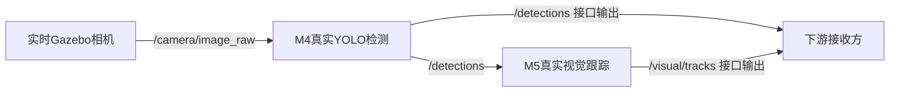

# M4视觉检测与M5视觉跟踪——实时验收总览

正式验收只覆盖本组M4视觉检测、M5视觉跟踪：实时Gazebo输入→真实算法→实时检测/航迹输出与展示。M3/M6/M8的算法处理由对应负责人验收，不作为本方完成前提。

|正式视频|实际来源|已验证内容|
|---|---|---|
|01_M0-M4_相机检测.mp4|11月14日实时Gazebo，非回放/人工检测|相机输入、真实模型出框与置信度、/detections、空结果、目标恢复|
|02_M4-M5_视觉跟踪.mp4|同一实时Gazebo与原M4/M5节点|真实检测输入、/visual/tracks、ID/bbox/area_ratio、移动跟踪、离场清轨和重入建轨|

正式索引只有这两段：[视频大小、时长、SHA和原完整读帧记录](实时视频证据索引-20261114.json)。两段当前SHA与此前完整解码通过的原件相同，无需补录。视频由成员另行发群，不进Git；不把Windows本机路径当分享链接。

01原bag254张图像、89检测/89调试图；02原bag91检测/91航迹。02动作事件中离场27条航迹全空、重入有ID152/153/154；26个非空航迹样本的xywh有效、面积计算与320×240一致。原录包与事件观察窗口不同，不混用计数。

接收话题存在不是唯一依据：有同次M0连接、相机/Gazebo时钟与模型状态、真实ONNX与节点日志、原目标动作脚本和实际画面对应。脚本只录bag并调用Gazebo目标服务，没有播放bag来冒充本次实时测试。详[核验报告](最终交付核验报告-20261116.md)。

## 复现与测试

[M4使用与模型依赖](../../M4/模块使用文档.md)、[M5使用与自身测试](../模块使用文档.md)、[VM定位](VM定位.md)。已有M0会话须source其本次connection.bash；test/flow/M0-M4/run.sh可组合启动M4/M5，不另起master、不重复启动节点。M5单独入口roslaunch uav_tracking visual_tracker.launch；输出观察rostopic echo /detections与/visual/tracks，检测画面/detector/debug_image。

自身单元/E2E及离线回归继续保留，但离线结果只作为算法/接口辅助，不替代01/02实时证据。已有85项联合回归、M5 E2E A/B/C和历史103项均有原日志；本轮没有重跑大型测试或仿真。

## 已知限制与边界

保留漏检、空航迹、ID重建与异步叠加。能证明基本实时功能和输出字段正确，不能宣称每帧必检、零ID切换、严格同帧或严格真值准确率。最新帧主动跳帧不解释所有漏检。组长已接受处理最新帧并发布处理好的结果。

必要接口文档保留：M4 /detections供M5/M8，M5 /visual/tracks供M6/M8；像素框尺寸及消息类型不变。下游算法响应、状态锁定阈值、PID输出和整机飞行不列本方验收项目，也不作为提交阻塞。历史下游演示退出正式证据，原件保留仓库外；共享工具保留且明确非正式入口。
