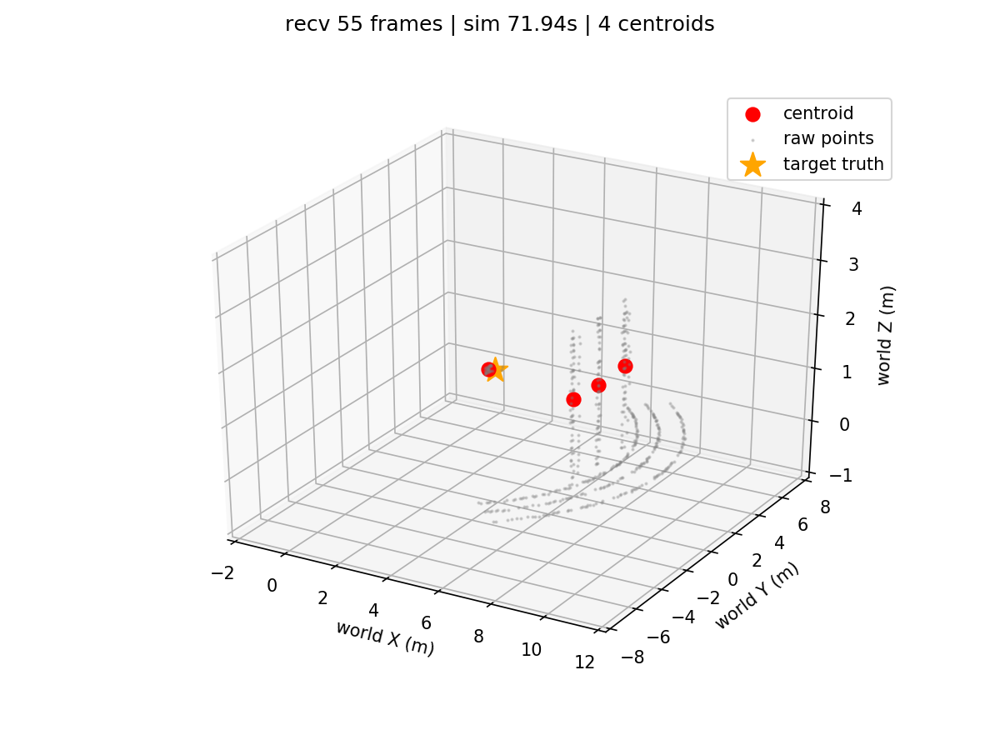

# M0-M1 联调：点云聚类可视化

M0（Gazebo 仿真）在数据源侧把雷达点云转换到 `world` 后发布 `/radar/points`，M1（`/cluster`）输出 world 系的 `/radar/centroid`。本目录的脚本把质心实时画成三维散点，用于判断「输入是否为规范点云、输出是否符合预期」。

## 目录

| 路径 | 内容 |
|---|---|
| `python/live_centroid_view.py` | 实时三维可视化脚本（world 系，本流程使用） |
| `python/world_centroid_view.py` | M0 侧提供的 world 版查看器（保留，未接入本流程） |
| `python/test_world_centroid_view.py` | 上述查看器的离线单测 |
| `image/live_centroid_view.png` | 界面截图（world 改造前的局部系版本，仅看布局） |
| `log/` | 长期保留的运行日志，当前为空 |

## 前置检查

`/radar/points` 必须是 `world`：

```bash
rostopic echo -n1 /radar/points --noarr | grep frame_id
```

输出 `frame_id: "world"` 才能继续。若仍是 `radar_link`，说明 `ray_cloud_bridge` 的世界坐标改造尚未编译生效（先 `catkin_make` 再重启仿真）；此时脚本会整帧拒绝并在标题显示 `DATA REJECTED: ...`。

## 启动方法

三个终端。M0 使用独立 ROS master（端口随机），后两个终端都要 source 同一次运行的 `connection.bash`。

### 终端 A：启动 M0 仿真

```bash
cd /home/demo/桌面/ai4
bash catkin_ws/src/uav_sim/scripts/start_mounted_radar.sh
```

记下它打印的「雷达/相机数据目录：$RUN_DIR」，等待查看器窗口出现。

### 终端 B：启动 M1 聚类

```bash
cd /home/demo/桌面/ai4
source /opt/ros/noetic/setup.bash
source catkin_ws/devel/setup.bash
source data/radar/<RUN_DIR>/connection.bash
roslaunch uav_tracking cluster.launch
```

### 终端 C：启动可视化

```bash
cd /home/demo/桌面/ai4
source /opt/ros/noetic/setup.bash
source catkin_ws/devel/setup.bash
source data/radar/<RUN_DIR>/connection.bash
/usr/bin/python3 test/flow/M0-M1/python/live_centroid_view.py --with-cloud --show-truth
```

必须用系统 `/usr/bin/python3`（rospy 装在该解释器下）。脚本只订阅，不启动 M0 或 M1。

## 参数

| 参数 | 说明 |
|---|---|
| `--duration 30` | 运行秒数，0（默认）表示直到 Ctrl+C |
| `--with-cloud` | 叠加降采样后的原始点云（默认 500 点，用 `--max-cloud-points` 调整） |
| `--show-truth` | 叠加目标真值（橙色星，需 `/target/ground_truth/pose`） |
| `--save out.png` | 退出前保存画面 |
| `--xlim / --ylim / --zlim` | 坐标轴范围，默认 `-2 12` / `-8 8` / `-1 4` |

## 预期效果



- 红色为 M1 输出的质心，灰色为原始点云，橙色星为目标真值；
- 三者都在 `world` 系（x 东、y 北、z 上），原点为 Gazebo 世界原点；
- 世界系下固定场景位置不变，只有目标机在移动；
- 标题实时显示接收帧数、仿真时间与当前帧质心数。

`image/` 里的截图拍摄于 world 改造之前，只能参考界面布局；重新运行一次后可替换。

## 已知限制

- 脚本强制校验 `world`：非 world 帧整帧拒绝，标题显示 `DATA REJECTED` 与具体 frame 名；
- `CentroidArray` 外层没有 header，frame 与时间戳取首个元素；同一帧内时间戳不一致会被拒绝；
- matplotlib 三维渲染约 0.3 s/帧，实测接收约 3 Hz，是显示端上限；M1 实际输出 5 Hz。
